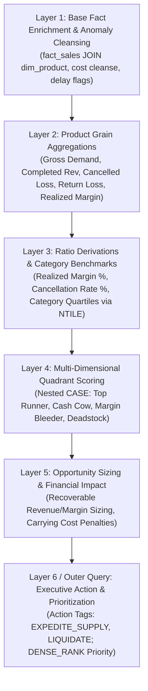

# Product Requirements Document (PRD) & Implementation Plan
## Lasagna SQL Query Pattern, Parser Stress-Testing Suite & Retail Friction Model

- **Document Owner:** Product Management (Analytics & Tooling)
- **Status:** Draft / In-Review
- **Target Repository:** `ianfinkdata/sql-practice`
- **Database Engine:** SQLite 3.x (Oakhaven Medallion Data Warehouse)
- **Target Milestones:** Q3 2026 Core Analytics & Agent Capabilities

---

## 1. Executive Summary & Problem Statement

### 1.1 The Business Problem (Retail Supply Chain & Merchandising)
In multi-channel retail operations like **Oakhaven Outdoor Outfitters**, gross margin targets frequently fail to materialize due to hidden operational friction:
1. **Stockout & Fulfillment Shortage on "Runners":** Top-revenue, high-margin catalog items experience stockouts, allocation delays, and order cancellations. Customers cancel orders due to fulfillment delays, resulting in direct margin leakage ($8.7K+ recoverable on leading footwear SKUs alone).
2. **Shelf Space & Working Capital Drag ("Deadstock"):** Low-velocity, low-margin products sit in distribution centers, consuming cubic storage space and incurring holding costs while contributing negligible profit.
3. **Margin Bleeders:** Products generating high gross order volume that suffer heavy promotional discount erosion and elevated return rates.

### 1.2 The Technical Problem (Legacy "Lasagna SQL" & AST Parser Fragility)
Enterprise data warehouses and legacy business intelligence tools (Cognos, MicroStrategy, SAP BusinessObjects, legacy Oracle/Teradata stacks) frequently authored complex business rules as monolithic, deeply nested subqueries—colloquially termed **"Lasagna SQL"** (5–7+ layers of nested `SELECT ... FROM (SELECT ...)` with layered `CASE` statements).

Modern semantic parsers, TMDL compilers, lineage engines, and SQL transpilers frequently break or mis-resolve column scopes when encountering:
- Deep AST recursion depth (exceeding standard parser stack thresholds).
- Multi-tier alias shadowing and derived column projection across nested scopes.
- Nested conditional expressions (`CASE WHEN ... THEN (CASE WHEN ...) END`) combined with window functions inside subquery layers.
- Grouping aggregations wrapped inside outer window partitions.

---

## 2. Product Objectives & Acceptance Criteria

### 2.1 Objectives
1. **Develop a Ground-Truth Retail Business Model:** Build a 6-layer analytical query calculating SKU velocity quadrants, fulfillment friction indices, stockout opportunity loss, and carrying cost penalties using verified `project/oakhaven.db` data.
2. **Pressure Test SQL Parsers:** Create a deterministic benchmark for SQL AST parsers, TMDL lineage mappers, and query transpilers against legacy nested query anti-patterns.
3. **Deliver a Reusable Agent Skill (`lasagna-sql-generator`):** Package the generator, dialect translators (Snowflake, BigQuery, PostgreSQL, Databricks), and AST depth analyzers into an easily invocable agent skill.
4. **Provide Clean Modern Refactoring:** Offer a 1-to-1 refactored Common Table Expression (CTE) equivalent for every lasagna query to teach modern SQL best practices.

### 2.2 Strict Ground-Truth Data Rules (AGENTS.md Compliance)
- All numbers, row counts, dollar amounts, and rates cited must be **actual, verified outputs** from `project/oakhaven.db` (Seed `20260630`).
- No fabricated figures or synthetic estimates.
- `project/oakhaven.db` is strictly read-only.

---

## 3. Exploratory Data Analysis (EDA) Findings on Oakhaven

The model is built upon verified facts from `project/oakhaven.db`:

| Metric Domain | Verified Value (Oakhaven DB) | Strategic Implication |
| :--- | :---: | :--- |
| **Total Order Lines (`fact_sales`)** | 12,000 lines ($8,742,289.04 net) | Broad transaction base spanning 2021–2026. |
| **Completed Orders** | 7,108 lines ($5,115,496.71) | 59.2% fulfillment completion rate. |
| **Cancelled Orders (Friction)** | 1,916 lines ($1,458,107.28) | **16.0% cancellation rate** ($1.46M revenue leakage). |
| **Returned Orders (Friction)** | 1,736 lines ($1,281,918.40) | **14.5% return rate** ($1.28M revenue reversed). |
| **Shipping Delay (>7 Days)** | 2,868 lines ($2,094,904.47) | 23.9% of orders experience severe fulfillment delays. |
| **Negative Cost Anomaly** | 2 products (e.g. SKU 19 `unit_cost = -4.19`) | Handled via Layer 1 data cleansing `CASE` logic. |
| **Top Category Revenue** | Climbing ($1,389,650.95), Winter Sports ($1,249,691.54) | High value categories with elevated stockout risk. |

---

## 4. Architectural Anatomy of the 6-Layer Lasagna Query

### Layer Breakdown:
- **Layer 1 (`l1` - Base Fact Grain)**: Cleanses negative unit costs (`CASE WHEN unit_cost <= 0 THEN unit_price * 0.45`), filters orphan products, and computes delivery delay flags (`julianday(ship_date) - julianday(order_date) > 7`).
- **Layer 2 (`l2` - Product Rollup)**: Aggregates total demand, completed units, completed revenue, cancelled revenue loss, return revenue loss, and realized COGS/Gross Profit.
- **Layer 3 (`l3` - Benchmark Ratios & Window Quartiles)**: Computes realized margin percentage, cancellation rate, return rate, category revenue quartile (`NTILE(4)`), category margin quartile, and category average cancellation rate.
- **Layer 4 (`l4` - Velocity Quadrant Scoring)**: Uses 3-level nested `CASE` statements to classify SKUs into `Top Runner - High Stockout Risk`, `Cash Cow - Core Engine`, `Volume Driver - Margin Bleeder`, `Deadstock - Shelf Space Drag`, `Slow Mover - Low Margin`, and `Niche Specialty`.
- **Layer 5 (`l5` - Financial Opportunity Loss Sizing)**: Models recoverable shortage revenue ($`cancelled_loss * (1 - cat_avg_cancel / cancel_rate)`$), recoverable margin, and deadstock holding cost penalty ($`units * cost * 0.18`$).
- **Layer 6 (Outer Query - Executive Prioritization)**: Assigns strategic operational directives (`EXPEDITE_SUPPLY & EXPAND_SAFETY_STOCK`, `LIQUIDATE_CLEARANCE & REALLOCATE_SHELF_SPACE`) and ranks by net value at stake.

---

## 5. Technical Deliverables & Milestones

### Milestone 1: PRD Draft & GitHub Issue Tracking
- [x] Document business case, data facts, and PRD in `docs/implementation_plans/prd_lasagna_query_and_parser_stress_testing.md`.
- [x] Commit and push PRD to `origin/main`.
- [x] Open tracking Issue on GitHub referencing the implementation plan.

### Milestone 2: Verified SQL Patterns in Portfolio
- [ ] Add `portfolio/05-analytical-query-patterns/lasagna-retail-fulfillment-margin-leakage.sql`:
  - Full verified 6-layer lasagna query with exact Oakhaven output.
  - Full verified modern CTE refactored companion query.
  - Step-by-step layer annotations and AST parser vulnerability analysis.
  - Multi-dialect portability notes (Snowflake, BigQuery, Databricks, PostgreSQL).

### Milestone 3: Dedicated CLI Tools & Generator
- [ ] Build `scripts/generate_lasagna_query.py`:
  - Configurable subquery nesting depth (3 to 7 layers).
  - Target dialect generation (SQLite, Snowflake, BigQuery, Postgres).
  - Live query runner & result verification against `project/oakhaven.db`.
- [ ] Build `scripts/verify_sql_parser_stress.py`:
  - Analyzes AST depth, nested projections, derived column lineage, and alias shadowing.

### Milestone 4: Dedicated Agent Skill (`lasagna-sql-generator`)
- [ ] Create `.agents/skills/lasagna-sql-generator/SKILL.md`:
  - Complete prompt templates, CLI invocation instructions, and refactoring guidelines.

---

## 6. Verification & Quality Assurance Plan

1. **Deterministic Verification:** Ensure `python project/build.py` produces identical hashes and all sample query results match `sqlite3 project/oakhaven.db`.
2. **Read-Only Database Integrity:** Zero DDL/DML executed against `project/oakhaven.db`.
3. **AST Parser Compatibility Check:** Run TMDL and SQL parsing tools against the generated lasagna scripts to verify stress-test coverage.
