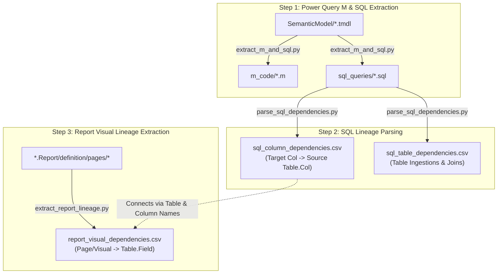

# End-to-End Power BI Lineage Toolkit (`tmdl-py-scripts`)

A complete, production-ready Python lineage toolkit for Power BI / Microsoft Fabric projects that connects the entire data lifecycle:

**Physical SQL Database** &nbsp;→&nbsp; **Power Query M** &nbsp;→&nbsp; **Semantic Model Tables** &nbsp;→&nbsp; **Report Pages & Visuals**

---

## 📁 Repository Structure

```text
C:\github\tmdl-py-scripts\
│
├── scripts/
│   ├── extract_m_and_sql.py        # Step 1: Extracts raw M let...in scripts & restores clean ANSI SQL queries
│   ├── parse_sql_dependencies.py   # Step 2: Parses SQL CTEs, Joins & Projections -> Column & Table Lineage CSVs
│   └── extract_report_lineage.py   # Step 3: Extracts all Page & Visual JSON columns, measures & filters -> CSV
│
├── oakhavenprojecttemplate.pbip    # Power BI Project definition
├── oakhavenprojecttemplate.SemanticModel/
│   └── definition/tables/          # Source TMDL table definitions
├── oakhavenprojecttemplate.Report/
│   └── definition/pages/           # Source Report pages & visual JSON definitions
│
├── extracted_outputs/              # Step 1 Output: Extracted .m and .sql files
├── sql_column_dependencies.csv     # Step 2 Output: SQL Column-to-Source Lineage
├── sql_table_dependencies.csv      # Step 2 Output: SQL Table Ingestion & Join Flow
├── report_visual_dependencies.csv  # Step 3 Output: Report Page & Visual Field Lineage
└── README.md                       # This guide
```

---

## 🚀 End-to-End Lineage Workflow



---

## 🛠️ Step 1: Extract M Code & Restore ANSI SQL

Extracts raw Power Query `let...in` expressions and cleans M formatting into pure SQL queries.

```powershell
python scripts/extract_m_and_sql.py
```

* **Output**: Writes `.m` scripts and clean `.sql` queries into `extracted_outputs/`.

---

## 📊 Step 2: Parse SQL Dependencies & Generate Lineage CSV

Parses all extracted SQL queries across CTEs, nested subqueries, joins, and aliases, and outputs column- and table-level lineage into structured `.csv` tables.

```powershell
python scripts/parse_sql_dependencies.py
```

* **Output**:
  * `sql_column_dependencies.csv`: Tracks each query's output columns to physical source schemas, tables, and columns.
  * `sql_table_dependencies.csv`: Tracks all table ingestions, CTE definitions, and join relationships.

---

## 📈 Step 3: Extract Report Page & Visual Field Lineage

Scans all `.Report` folders, inspecting `pages.json`, `page.json`, and every `visual.json` container to extract all referenced tables, columns, explicit measures, implicit aggregations, and filters.

```powershell
python scripts/extract_report_lineage.py
```

* **Optional Flags**:
  * `--input-dir "path/to/reports"` : Custom workspace directory to scan.
  * `--output-csv "report_visual_dependencies.csv"` : Custom output file path.

---

## 📋 Generated CSV Schema Reference

### 1. Report Visual Lineage (`report_visual_dependencies.csv`)
Tracks every field, measure, and filter used across all report pages and visual containers:

| Column | Description | Example |
| :--- | :--- | :--- |
| `project_name` | Parent PBIP project name | `oakhavenprojecttemplate` |
| `report_folder` | Name of `.Report` folder | `oakhavenprojecttemplate.Report` |
| `page_name` | User-friendly page display name | `Page 1` |
| `page_id` | Page folder GUID / ID | `2e2100c152be0473aa0e` |
| `visual_id` | Visual container GUID / ID | `1715ba03a592188ad730` |
| `visual_type` | Power BI visual type | `tableEx`, `clusteredBarChart`, `card` |
| `data_role` | Data field role | `Values`, `Category`, `Series`, `X`, `Y` |
| `field_type` | Field category | `COLUMN`, `MEASURE`, `AGGREGATION`, `HIERARCHY_LEVEL` |
| `table_name` | Referenced table / entity | `dim_customer`, `_measures`, `fact_sales` |
| `field_name` | Column or Measure name | `customer_segment`, `Total Revenue` |
| `aggregation` | Aggregation applied | `NONE`, `EXPLICIT_MEASURE`, `SUM`, `COUNT` |
| `query_ref` | Full model query reference | `dim_customer.customer_segment` |
| `usage_type` | Field context | `VISUAL_PROJECTION`, `VISUAL_FILTER`, `PAGE_FILTER`, `REPORT_FILTER` |

### 2. SQL Column-Level Lineage (`sql_column_dependencies.csv`)
Tracks every query projection back to physical source database columns:

| Column | Description | Example |
| :--- | :--- | :--- |
| `query_file` | Source SQL query file | `flat_sales_all.sql` |
| `target_entity` | Target reporting table/view | `flat_sales_all` |
| `target_column` | Output column / alias name | `customer_name` |
| `source_table` | Physical source table | `dim_customer` |
| `source_column` | Physical source column | `full_name` |
| `transformation_type` | Transformation category | `DIRECT_PASSTHROUGH`, `ARITHMETIC_CALCULATION`, `CASE_EXPRESSION` |
| `expression_detail` | Raw SQL formula | `ROUND(f.quantity * f.unit_price, 2)` |

---

## 🔗 Combining into End-to-End Lineage

By joining `report_visual_dependencies.csv` ⟷ `sql_column_dependencies.csv` on `(table_name == target_entity AND field_name == target_column)`, you achieve complete end-to-end data tracing:

> **Report Visual (Page 1)** → `dim_customer.customer_segment` → **SQL View (`flat_sales_all`)** → **Source Table (`dim_customer.customer_segment`)**
